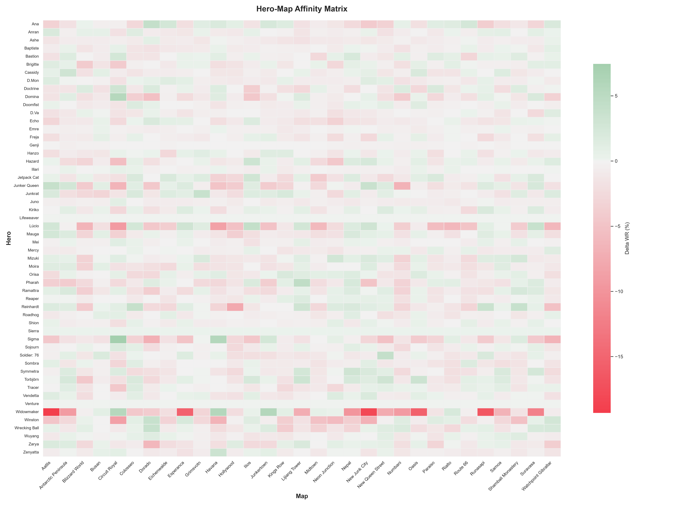
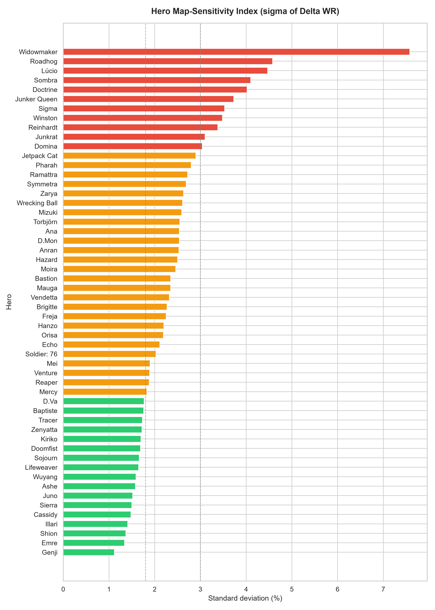
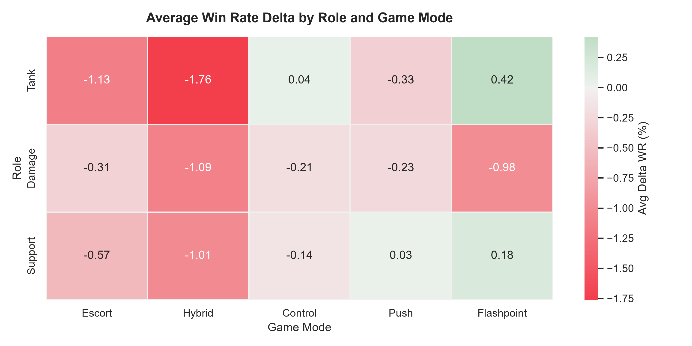
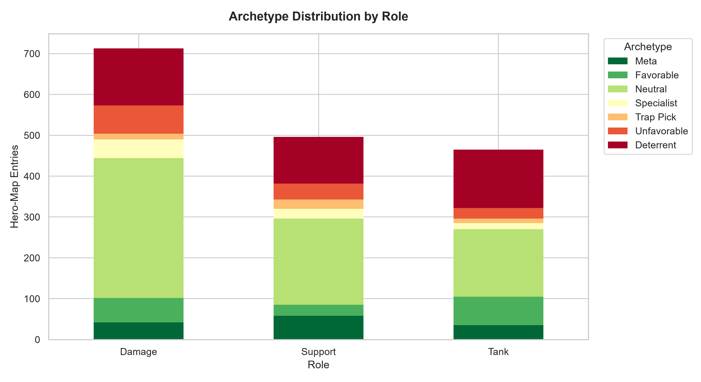
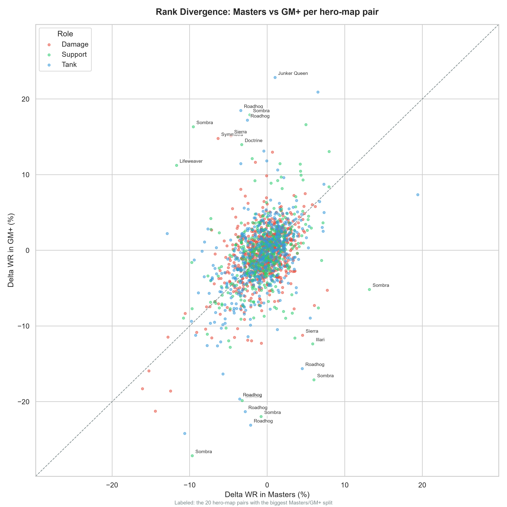

# Overwatch Map Affinity

Everybody knows that Overwatch heroes vary with their performance based on each map, and most can even name those cases, such as Winston being good at Watchpoint: Gibraltar. But still I wanted to see the extent of the map effect, and make a deep dive to find how each hero is effected by map changes. So, I pulled ranked win rate data and built something that answers it properly: for every hero, on every map, how much does their win rate move relative to their own average?

I didn't want to make a system that was dependant on patches, but rather wanted to find values that would stay the same regardless of hero's current balance or meta status, so I used "delta win rate" (map win rate minus the hero's baseline win rate for the same rank/region/patch slice). Of course this data is only valuable without any hero or map reworks, in those cases the data needs refreshing. But these values in this research should, in theory, survive regular balance changes.

**[Live Interactive Dashboard →](https://whenthiswinter.github.io/overwatch-map-affinity/)**



## What's in here

- **`analysis/`** — the actual pipeline: collect the data, compute deltas, spit out a dataset and a markdown report.
- **`data/`** — `history/` is the frozen OWTics harvest of past seasons, `snapshots/` holds a daily snapshot of Blizzard's and Nexon's official stats from Season 5 on, and `csv/` is for anyone who wants to have fun with it themselves in a spreadsheet or notebook. The site's dataset is rebuilt daily and lives at [`data/web_data.json`](https://whenthiswinter.github.io/overwatch-map-affinity/data/web_data.json) on the live site.
- **`.github/workflows/daily.yml`** — runs the whole thing every day: collect, check for a new patch, rebuild, redeploy.
- **`report/analysis_report.md`** — the full tier list, map by map, generated straight from the data.
- **`charts/`** — the visuals below, regenerable with one command.
- **`web/`** — a small dashboard: filter by rank/region, look up a map or a hero, build a pool of your mains and export an offline cheat sheet.

## The numbers

- **Delta WR** — a hero's win rate on a map minus their baseline win rate in that same rank/region/patch slice, averaged across every slice I collected (currently seasons 1-4 of 2026 including midseasons, Masters and up; season 5 is in progress, see *Provisional* below). Tiers: S ≥ +3.0%, A +1.2 to +2.9%, B ±1.1%, C −1.3 to −3.0%, D < −3.0%.
- **Delta PR** — pick rate lift on the map vs. the hero's average pick rate. Tells you whether a strong map is being drafted for, or slept on.
- **Archetype** — a rough read of delta WR crossed with delta PR: *Meta* (strong and popular), *Specialist* (strong but rarely picked), *Trap Pick* (weak but still picked a lot), *Deterrent* (weak and avoided).
- **Sigma (map sensitivity)** — standard deviation of a hero's delta across all maps. High sigma = map specialist, low sigma = plays about the same everywhere.
- **Rank divergence** — flags heroes whose delta shifts by 2.5%+ between Masters and GM/Champion, helpful in some edge cases where the disparity between Masters and GM+ can be big enough to be misleading.
- **Provisional** — the patch currently in progress (a season or its midseason half) is left out of the averages for its first 21 days, because the first weeks of a patch are thin and noisy. Heroes and maps that only exist in the current patch (new releases and reworks, like Doctrine, Grímsvötn, and the reworked Sombra and Roadhog in Season 5) are still shown, built from current-patch data alone and marked *Provisional*. After 21 days the patch counts like any other. The site's *Data* filter can also show the current patch on its own.
- **Confidence** — each number comes with a rough 95% range based on how much its slices disagree: *High* (±2.5 or less), *Medium* (up to ±5) or *Low* (wider, or a single slice; shown faded). Slices from one season aren't fully independent, so the range is on the optimistic side.
- **Minimum sample size** — a hero-map pair needs at least 3 qualifying season/tier/region slices before it shows up anywhere. Below that, a single unlucky slice (a hero with barely any games on a map happens to lose all of them) can swing the average by 30-50 points and look like a real result when it's really just noise. Filtering down to a specific rank or region thins out the slices fast, so a hero that shows up on the all-ranks/all-regions view can disappear from a narrower one — that's the filter doing its job, not a bug. The one exception is a hero or map that just hasn't existed long enough to ever reach 3 slices under a narrow filter (a hero released this season, or a map reworked this season) — those show with whatever slices actually exist instead of getting hidden entirely, so a new hero isn't invisible on the site until they've been around for months.

More charts, for the curious:

| | |
|---|---|
|  |  |
|  |  |

## Running the site

The dashboard is static, it just fetches `data/web_data.json`. That file isn't checked in, so build it first, then serve the folder (browsers block the fetch over `file://`):

```bash
python analysis/build_dataset.py
python -m http.server 8000
```

Then open `http://localhost:8000/web/index.html`.

## How the data stays fresh

Blizzard (Americas, Europe, Asia) and Nexon (Korea) publish per-map win and pick rates for the current patch only, cumulative since the patch started. So a GitHub Action ([`daily.yml`](.github/workflows/daily.yml)) saves a snapshot of them every day:

1. `analysis/collect_live.py` saves the day's snapshot to `data/snapshots/`.
2. `analysis/detect_patch.py` checks whether the numbers reset, which happens on season and midseason patches. When they do, the old patch is frozen at its last snapshot and a new one starts, labelled from Blizzard's patch notes. Anything that needs a human (a new patch to check for reworks, a hero or map I don't know about yet) opens a GitHub issue.
3. `analysis/build_dataset.py` combines the frozen history with the newest snapshot of every patch and the site gets redeployed.

The report, CSVs and charts are regenerated by hand (`pip install -r requirements.txt`, then `python analysis/report.py` and `python analysis/charts.py`).

Seasons 1-4 came from OWTics' API (`analysis/harvest.py`, which needs a `cf_clearance` cookie from a real browser session since OWTics sits behind Cloudflare) and were frozen into `data/history/` with `analysis/export_history.py`.

## Caveats

Heroes and maps added (or reworked) mid-timeframe are only counted from the season they were released or reworked in, so a rework starts that hero or map over from scratch (e.g. Sombra's move from Damage to Support in season 5).
